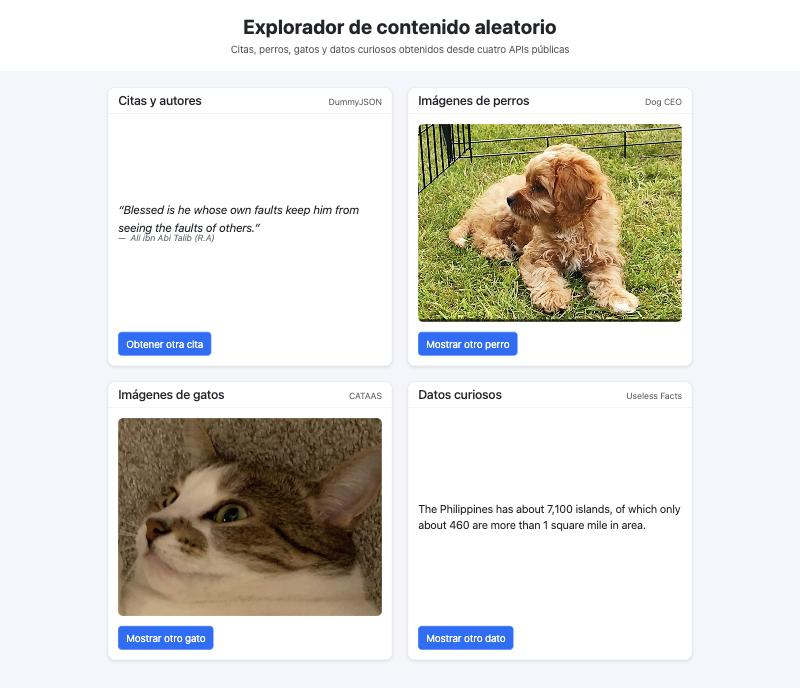
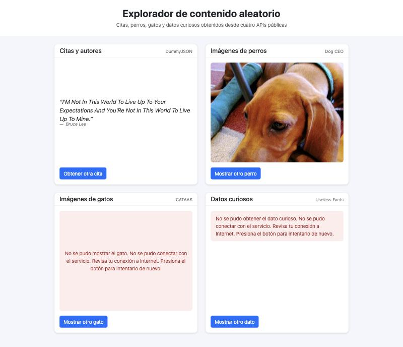

# Explorador de contenido aleatorio

**Programación Web III — Tarea: consumo de APIs públicas**

Página web que consume cuatro APIs públicas con `fetch` y `async/await` para mostrar
citas, imágenes de perros, imágenes de gatos y datos curiosos. Cada sección tiene su
propio botón y se actualiza de forma independiente, sin recargar la página.

## Integrantes

- _Nombre completo del integrante 1_
- _Nombre completo del integrante 2_

## Tecnologías

- HTML5
- CSS3 (estilos propios en `css/styles.css`)
- JavaScript (ES2017+, `fetch`, `async/await`, `try/catch`) en `js/app.js`
- Bootstrap 5.3 (cargado desde CDN, solo para la cuadrícula y los componentes visuales)

No se utiliza base de datos ni inicio de sesión.

## Estructura del proyecto

```
conexion API/
├── index.html          → estructura de la página (4 tarjetas)
├── css/
│   └── styles.css      → estilos propios
├── js/
│   └── app.js          → lógica: una función por API
├── capturas/
│   ├── 01-cuatro-secciones.jpg
│   └── 02-error-controlado.jpg
└── README.md
```

## Instrucciones de ejecución

Se necesita conexión a Internet, porque el contenido se obtiene de las APIs en cada consulta.

**Opción 1 — Visual Studio Code + Live Server (recomendada)**

1. Abrir la carpeta del proyecto en Visual Studio Code.
2. Instalar la extensión **Live Server**.
3. Clic derecho sobre `index.html` → **Open with Live Server**.

**Opción 2 — Servidor local con Python**

Desde la carpeta del proyecto:

```bash
python3 -m http.server 5500
```

Luego abrir `http://localhost:5500` en el navegador.

**Opción 3 — Abrir el archivo directamente**

Hacer doble clic en `index.html`. Algunos navegadores restringen las solicitudes hechas
desde archivos locales (`file://`); si alguna sección no carga, usar la opción 1 o 2.

## Funcionamiento

| Sección | API | Endpoint (GET) | Campo utilizado | Botón |
|---|---|---|---|---|
| Citas y autores | DummyJSON | `https://dummyjson.com/quotes/random` | `quote`, `author` | Obtener otra cita |
| Imágenes de perros | Dog CEO | `https://dog.ceo/api/breeds/image/random` | `message` (URL de la imagen) | Mostrar otro perro |
| Imágenes de gatos | CATAAS | `https://cataas.com/cat?json=true` | `id` → `https://cataas.com/cat/{id}` | Mostrar otro gato |
| Datos curiosos | Useless Facts | `https://uselessfacts.jsph.pl/api/v2/facts/random?language=en` | `text` | Mostrar otro dato |

Antes de programar se inspeccionó la respuesta de CATAAS. Ejemplo:

```json
{
  "id": "dmjubveyQIbCFA2v",
  "tags": ["orange"],
  "created_at": "2024-12-19T13:10:43.575Z",
  "url": "https://cataas.com/cat/dmjubveyQIbCFA2v?position=center",
  "mimetype": "image/jpeg"
}
```

Se utiliza el campo `id` para construir la URL `https://cataas.com/cat/{id}`, que se asigna
al atributo `src` de la imagen. La URL `https://cataas.com/cat` (sin `?json=true`) devuelve
directamente la imagen, por eso **nunca** se procesa con `response.json()`.

### Requisitos implementados

- **Una función independiente por API** en `js/app.js`: `obtenerCitaAleatoria()`,
  `obtenerPerroAleatorio()`, `obtenerGatoAleatorio()` y `obtenerDatoCurioso()`.
  Comparten una utilidad `solicitarJson(url)` que hace el `fetch`, verifica `response.ok`
  y devuelve `response.json()`.
- **Carga inicial:** al abrir la página se llaman las cuatro funciones en paralelo.
- **Actualización independiente:** cada botón llama solo a la función de su sección.
- **Estado de carga:** se muestra “Cargando…” durante cada consulta.
- **Control de botones:** el botón se deshabilita al empezar la solicitud y se vuelve a
  habilitar en el bloque `finally`, por lo que se habilita incluso si ocurre un error.
- **Manejo de errores:** se verifica `response.ok`; cualquier fallo (sin conexión, código
  HTTP de error, respuesta incompleta, tiempo de espera de 10 s agotado o imagen que no
  carga) se captura con `try/catch` y se muestra un mensaje comprensible con la
  indicación de volver a presionar el botón para reintentar.
- **Aislamiento de fallos:** cada función tiene su propio `try/catch`, así que si una API
  falla las demás secciones siguen funcionando.
- **Imágenes uniformes:** marco con `aspect-ratio: 4 / 3` y `object-fit: cover`, de modo que
  todas tienen el mismo tamaño y no se deforman. La imagen se precarga antes de mostrarla y
  se contempla el evento `error`. Cada imagen tiene texto alternativo (`alt`) descriptivo.
- **Diseño adaptable:** cuadrícula de Bootstrap: 2 × 2 en computadora y una columna en
  teléfono, con botones a todo el ancho en pantallas pequeñas.
- **Consultas nuevas en cada clic:** se usa `cache: "no-store"` en `fetch`. Si una API
  devuelve un resultado repetido, se debe a que el contenido es aleatorio.
- **Sin contenido simulado:** no hay citas, datos ni URLs de imágenes escritas a mano;
  todo proviene de las respuestas de las APIs.

## Capturas

**Cuatro secciones funcionando**



**Mensaje de error controlado** (se simuló la pérdida de conexión y se solicitó un nuevo gato
y un nuevo dato curioso; las secciones de citas y perros siguen funcionando)



## Preguntas de reflexión

### 1. ¿Qué es un endpoint y cuál utilizaste para cada API?

Un endpoint es una dirección URL concreta de una API a la que se envía una solicitud HTTP
(con un método como GET) para obtener o modificar un recurso específico. Es el “punto de
acceso” por el que el cliente se comunica con el servidor.

- **DummyJSON (citas):** `GET https://dummyjson.com/quotes/random`
- **Dog CEO (perros):** `GET https://dog.ceo/api/breeds/image/random`
- **CATAAS (gatos):** `GET https://cataas.com/cat?json=true` para obtener los datos en JSON, y
  luego `https://cataas.com/cat/{id}` como URL de la imagen.
- **Useless Facts (datos curiosos):** `GET https://uselessfacts.jsph.pl/api/v2/facts/random?language=en`

### 2. ¿Qué diferencia existe entre recibir JSON y recibir directamente una imagen?

Cuando se recibe **JSON**, la respuesta es texto con datos estructurados (objetos con campos
como `quote`, `message` o `id`). Ese texto se debe interpretar con `response.json()` para
convertirlo en un objeto de JavaScript y así leer sus propiedades.

Cuando se recibe **directamente una imagen**, la respuesta son datos binarios (por ejemplo,
`image/jpeg`). No es texto JSON, así que `response.json()` fallaría con un error de sintaxis.
Para mostrarla basta con colocar esa URL en el atributo `src` de una etiqueta `` y el
navegador se encarga de descargarla y dibujarla. Por eso, en CATAAS se consulta primero
`?json=true` para obtener el `id` y después se usa `https://cataas.com/cat/{id}` como `src`.

### 3. ¿Qué función cumplen `await` y `response.json()`?

`fetch` y `response.json()` son operaciones asíncronas: devuelven una **promesa** porque
tardan en completarse (dependen de la red). `await`, que solo se puede usar dentro de una
función `async`, pausa la ejecución de esa función hasta que la promesa se resuelva y
entrega su resultado, sin bloquear el resto de la página. Así el código se lee de arriba
hacia abajo, como si fuera síncrono.

`response.json()` lee el cuerpo de la respuesta HTTP y lo convierte de texto JSON a un
objeto de JavaScript. Como también devuelve una promesa, se usa con `await`:

```js
const response = await fetch(url);     // espera la respuesta del servidor
const datos = await response.json();   // espera y convierte el cuerpo a objeto
console.log(datos.quote);
```

### 4. ¿Por qué se debe verificar `response.ok` además de utilizar `try/catch`?

Porque `fetch` **solo rechaza la promesa cuando hay un fallo de red** (sin conexión, DNS,
bloqueo por CORS, etc.). Si el servidor responde con un código de error HTTP, como 404
(no encontrado) o 500 (error interno), `fetch` considera que la solicitud se completó y **no
lanza ningún error**, por lo que el `catch` no se ejecutaría.

`response.ok` es `true` solo cuando el código de estado está entre 200 y 299. Al verificarlo
y lanzar un error manualmente (`throw new Error(...)`) cuando es `false`, esos casos también
llegan al `catch` y se muestra el mensaje de error al usuario en lugar de intentar procesar
una respuesta inválida.

### 5. ¿Cómo lograste actualizar una sección sin recargar toda la página?

Usando JavaScript para manipular el **DOM** directamente. Cada botón tiene un
`addEventListener("click", ...)` que llama a la función de su sección. Esa función hace la
solicitud con `fetch` en segundo plano (de forma asíncrona) y, al recibir los datos,
modifica únicamente los elementos de esa tarjeta: `textContent` para la cita, el autor y el
dato curioso, y `src`/`alt` para las imágenes. Los botones son de tipo `type="button"`, así
que no envían ningún formulario ni provocan una recarga. El resto de la página no se toca,
por lo que las demás secciones mantienen su contenido.
